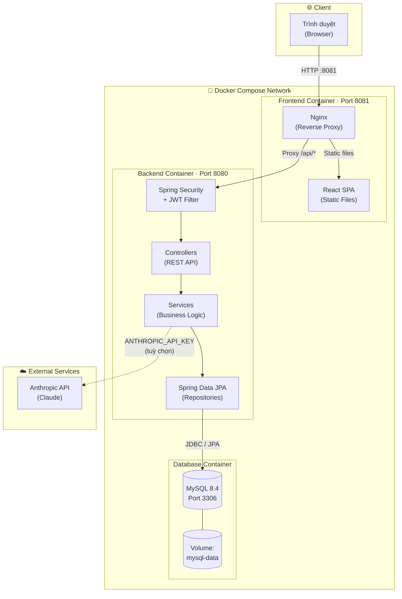
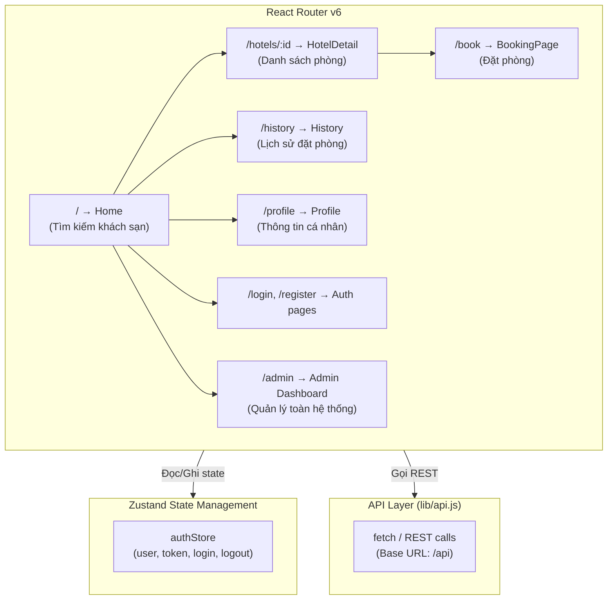
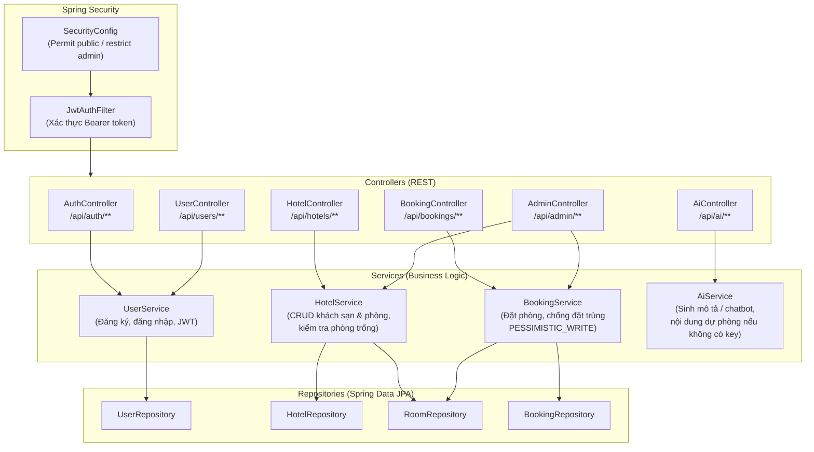
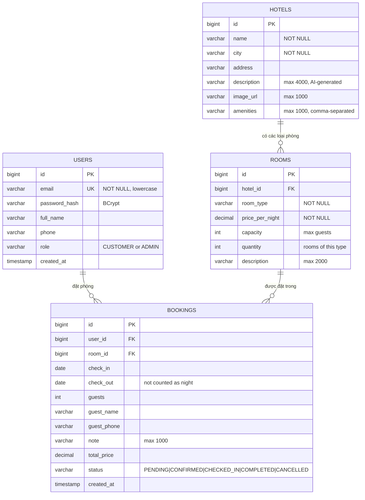
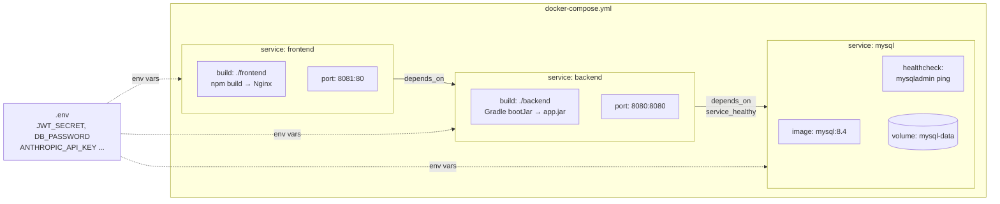
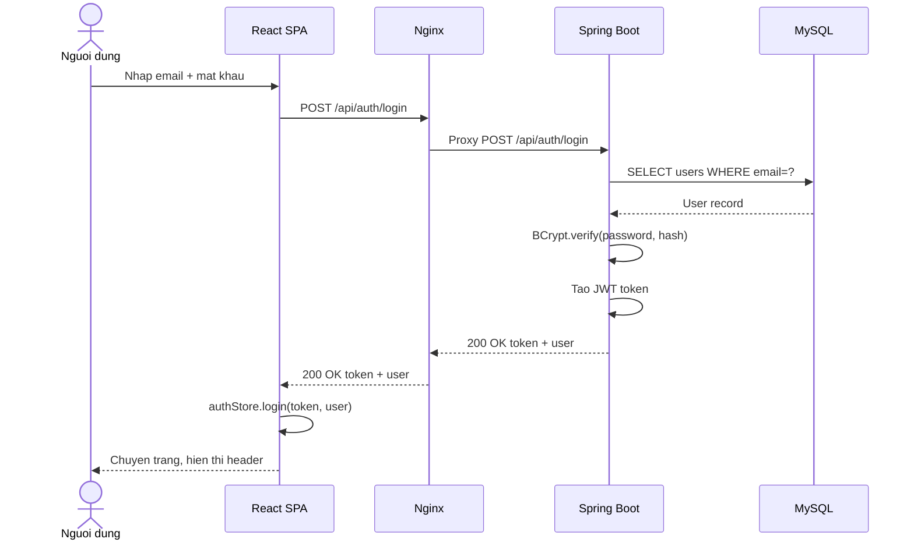
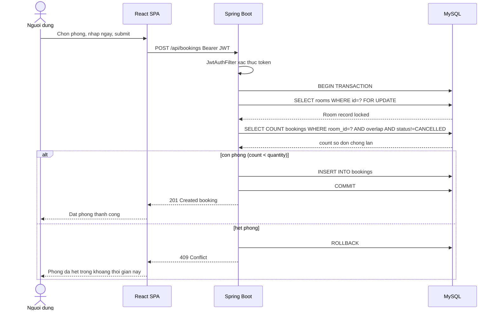
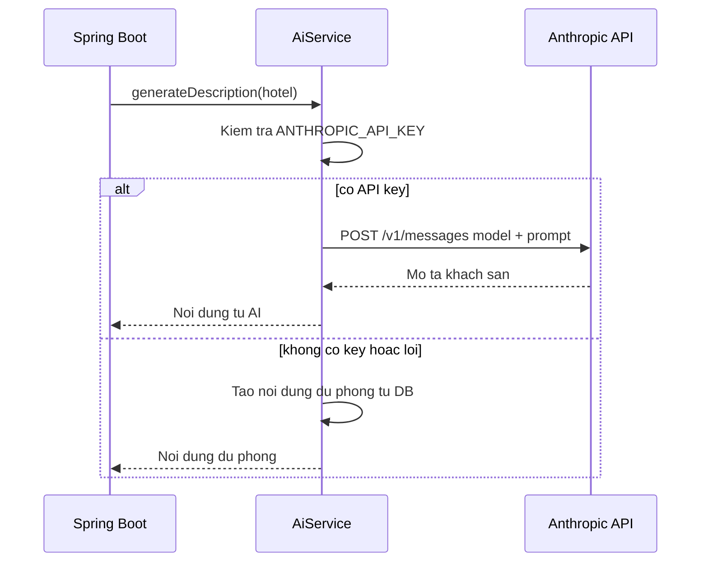

# QuickStay — Sơ đồ Kiến trúc Hệ thống

> Phiên bản 1.1 · 28/10/2026 · Nhóm 05

---

## 1. Tổng quan

QuickStay là hệ thống đặt phòng khách sạn gồm:

| Tầng | Công nghệ | Mô tả |
|---|---|---|
| **Frontend** | React 18 + Vite + Tailwind | SPA chạy trên Nginx |
| **Reverse Proxy** | Nginx (Alpine) | Phục vụ static files, forward `/api` → backend |
| **Backend** | Spring Boot 3.5 (Java 17) | REST API, JWT, Spring Security |
| **Database** | MySQL 8.4 | Lưu trữ dữ liệu chính |
| **AI (tuỳ chọn)** | Anthropic Claude API | Sinh mô tả khách sạn, chatbot |
| **Container** | Docker Compose | Orchestration toàn hệ thống |

---

## 2. Sơ đồ kiến trúc tổng thể

---

## 3. Sơ đồ Frontend (React SPA)

---

## 4. Sơ đồ Backend (Spring Boot)

---

## 5. Sơ đồ Database (ERD)

---

## 6. Sơ đồ Docker Compose

---

## 7. Luồng xử lý request (Request Flow)

### 7.1. Luồng đăng nhập

### 7.2. Luồng đặt phòng (chống đặt trùng)

### 7.3. Luồng AI (với fallback)

---

## 8. Bảng tóm tắt công nghệ

| Thành phần | Công nghệ | Phiên bản | Vai trò |
|---|---|---|---|
| Frontend | React + Vite | 18 / 6.x | SPA đặt phòng |
| State Management | Zustand | 5.x | Global auth state |
| Styling | Tailwind CSS | 3.x | UI |
| Reverse Proxy | Nginx | Alpine | Phục vụ SPA, proxy API |
| Backend | Spring Boot | 3.5.6 | REST API |
| Ngôn ngữ | Java | 17 | Backend runtime |
| Security | Spring Security + jjwt | 0.12.6 | Xác thực, phân quyền |
| ORM | Spring Data JPA / Hibernate | 3.x | Truy cập DB |
| Database | MySQL | 8.4 | Lưu trữ chính |
| Dev DB | H2 in-memory | — | Phát triển local |
| AI | Anthropic Claude | claude-* | Sinh mô tả, chatbot |
| Test | JUnit 5 / Vitest / E2E mjs | — | 46 BE + 8 FE + E2E |
| Container | Docker + Compose | — | Triển khai |
| CI/CD | GitHub Actions | — | Build, test, push GHCR |

---

## 9. Tài liệu liên quan

- [README](../README.md)
- [ERD và từ điển dữ liệu](QuickStay-ERD.md)
- [API Reference](QuickStay-API.md)
- [Test Report](QuickStay-Test-Report.md)
- [Docker Compose](../docker-compose.yml)
