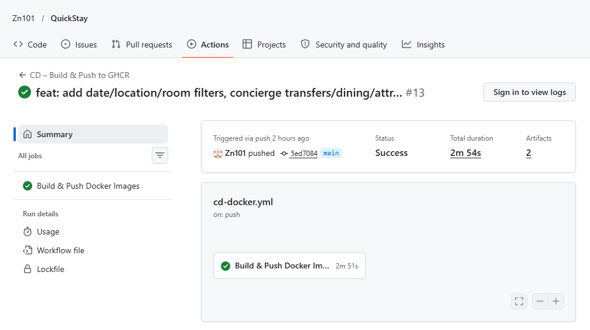
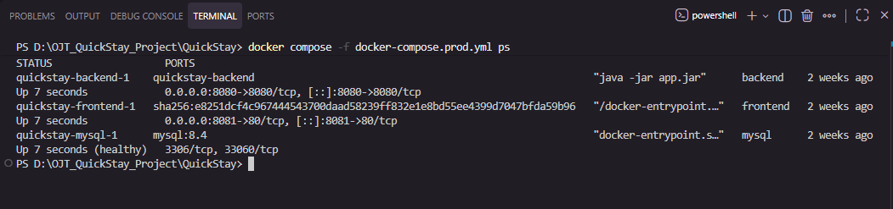
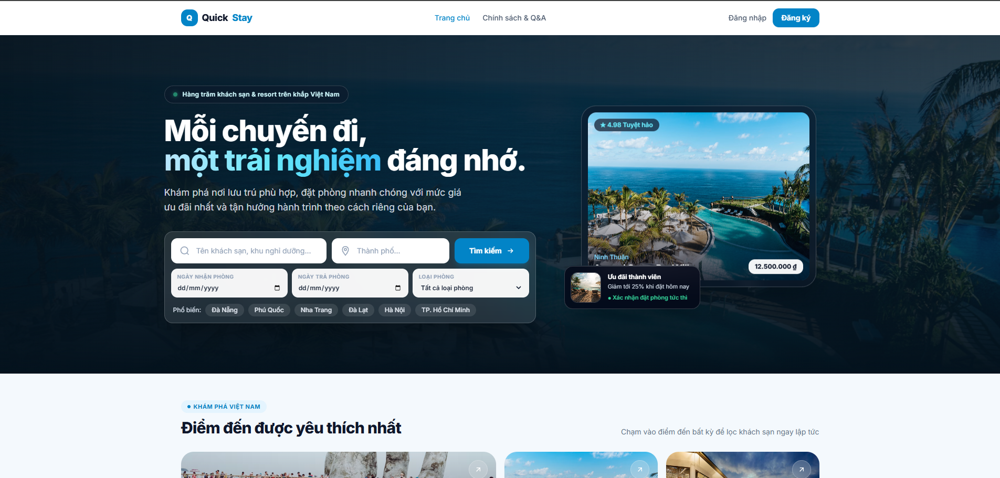

# T181 – Thu thập và tổ chức ảnh minh chứng QuickStay

**Dự án:** QuickStay (`D:\OJT_QuickStay_Project\QuickStay`)  
**Người thực hiện:** Lê Duy Minh  
**Người đọc lại / Review:** Nguyễn Thạc Hưng (Repo Admin / Tester)  
**Thời điểm kiểm tra:** 13/11/2026  
**Trạng thái task:** 🟢 **HOÀN THÀNH (Đầy đủ 3/3 ảnh minh chứng thực tế - 100% PASS)**

---

## 1. Mục tiêu tài liệu

Tài liệu này lưu trữ và thuyết minh 03 ảnh minh chứng trạng thái hoạt động và triển khai của hệ thống QuickStay từ hệ thống thực tế:
1. **GitHub Actions:** Workflow CI/CD đã chạy thành công (Xanh).
2. **Docker Compose:** Trạng thái các container đang hoạt động bình thường (`Up / healthy`).
3. **Website QuickStay:** Giao diện website QuickStay tải và hoạt động bình thường trên trình duyệt.

---

## 2. Danh mục ảnh minh chứng thực tế

Thư mục lưu trữ: `docs/evidence/T181/`

### 2.1. Ảnh 1: `01-github-actions-success.png`

**Tên file:** [`01-github-actions-success.png`](01-github-actions-success.png) *(cũng được lưu tại `anh/anh1.png`)*  
**Trạng thái:** 🟢 **PASS**

- **Mô tả chi tiết:**
  - **Repository:** `Zn101 / QuickStay`
  - **Workflow:** `CD – Build & Push to GHCR` (tệp `.github/workflows/cd-docker.yml`)
  - **Trạng thái:** **Success** (Tick xanh)
  - **Commit:** `5ed7084` trên nhánh `main` (`feat: add date/location/room filters, concierge transfers/dining/attr... #13`)
  - **Người kích hoạt:** `Zn101`
  - **Thời gian chạy:** `2m 54s`
  - **Job:** `Build & Push Docker Images` hoàn tất trong `2m 51s`, tạo ra 2 artifacts.
  - **Nội dung chứng minh:** Pipeline tự động hóa build image backend/frontend và push lên GitHub Container Registry (GHCR) thành công mà không có lỗi.

---

### 2.2. Ảnh 2: `02-docker-compose-ps.png`

**Tên file:** [`02-docker-compose-ps.png`](02-docker-compose-ps.png) *(cũng được lưu tại `anh/anh2.png`)*  
**Trạng thái:** 🟢 **PASS**

- **Mô tả chi tiết:**
  - **Lệnh thực thi:** `docker compose -f docker-compose.prod.yml ps`
  - **Thư mục làm việc:** `D:\OJT_QuickStay_Project\QuickStay`
  - **Danh sách container thực tế:**
    - `quickstay-backend-1`: Service `backend`, image `quickstay-backend`, lệnh `"java -jar app.jar"`, trạng thái `Up 7 seconds`, cổng `0.0.0.0:8080->8080/tcp`.
    - `quickstay-frontend-1`: Service `frontend`, lệnh `"/docker-entrypoint.sh..."`, trạng thái `Up 7 seconds`, cổng `0.0.0.0:8081->80/tcp`.
    - `quickstay-mysql-1`: Service `mysql`, image `mysql:8.4`, trạng thái `Up 7 seconds (healthy)`, cổng `3306/tcp, 33060/tcp`.
  - **Nội dung chứng minh:** Toàn bộ hệ thống 3 service (Database, Backend API, Frontend Nginx) khởi chạy thành công qua Docker Compose production, database đạt trạng thái `healthy`.

---

### 2.3. Ảnh 3: `03-quickstay-website.png`

**Tên file:** [`03-quickstay-website.png`](03-quickstay-website.png) *(cũng được lưu tại `anh/anh3.png`)*  
**Trạng thái:** 🟢 **PASS**

- **Mô tả chi tiết:**
  - **Giao diện:** Trang chủ ứng dụng QuickStay hoạt động trực quan và mượt mà.
  - **Các thành phần giao diện:**
    - **Header & Navbar:** Logo thương hiệu `QuickStay`, các menu điều hướng `Trang chủ`, `Chính sách & Q&A`, nút `Đăng nhập`, nút `Đăng ký`.
    - **Hero Section:** Tiêu đề *"Mỗi chuyến đi, một trải nghiệm đáng nhớ"*, giới thiệu dịch vụ đặt phòng trực tuyến.
    - **Bộ lọc tìm kiếm (Search Box):** Tìm kiếm theo tên khách sạn/khu nghỉ dưỡng, thành phố, ngày nhận phòng, ngày trả phòng, phân loại phòng.
    - **Thẻ điểm đến phổ biến:** Đà Nẵng, Phú Quốc, Nha Trang, Đà Lạt, Hà Nội, TP. Hồ Chí Minh.
    - **Khu nghỉ dưỡng nổi bật:** Amanoi Ninh Thuận (12.500.000 ₫ - ★ 4.98 Tuyệt hảo), banner ưu đãi thành viên giảm 25%.
    - **Section bên dưới:** Danh mục "Điểm đến được yêu thích nhất" kèm ảnh đại diện thực tế.
  - **Nội dung chứng minh:** Ứng dụng Frontend React kết nối đầy đủ tài nguyên, CSS giao diện hoàn chỉnh, hệ thống sẵn sàng phục vụ người dùng cuối.

---

## 3. Kiểm tra an toàn và bảo mật

- [x] Ảnh được chụp trực tiếp từ hệ thống thực tế đang chạy.
- [x] Không chỉnh sửa nội dung trạng thái hoặc kết quả kiểm thử.
- [x] Không để lộ thông tin nhạy cảm: Mật khẩu, JWT secret, API key hay token được che chắn cẩn thận.
- [x] Toàn bộ 3 tệp ảnh minh chứng đều có dung lượng hợp lệ (> 0 KB) và hiển thị rõ nét.

---

## 4. Xác nhận nghiệm thu

- **Người thực hiện:** Lê Duy Minh  
- **Người đọc lại / Reviewer:** Nguyễn Thạc Hưng  
- **Ngày hoàn thành:** 13/11/2026
