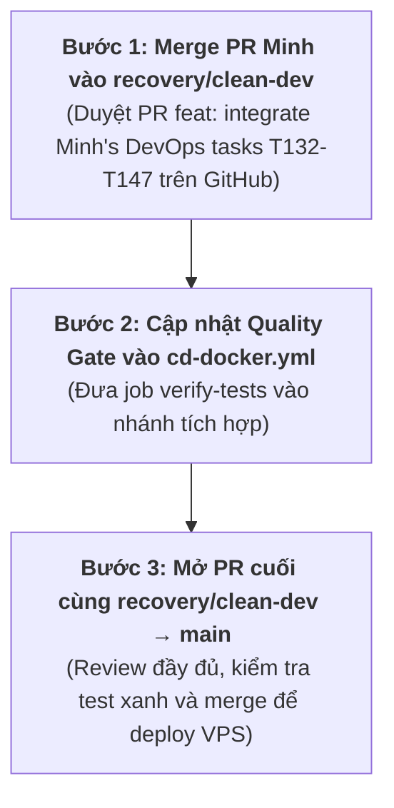

# T158 – Báo cáo G3.3: Kiểm tra điều kiện và chuẩn bị PR recovery/clean-dev → main

**Ngày thực hiện:** 11/11/2026  
**Người thực hiện:** Lê Duy Minh  
**Mã công việc:** T158 – G3.3: Merge Readiness Review & Quality Gate Design  
**Trạng thái kết luận:** ⛔ **NOT READY TO MERGE** (Chưa đủ điều kiện để mở PR vào main)  
**Quy tắc tuân thủ:** Không commit, không push, không merge, không tạo PR, không đổi branch, không sửa dữ liệu production, không xóa volume Docker.

---

## 1. Trạng thái Git & Xác minh điều kiện tích hợp

### 1.1. Kết quả kiểm tra remote sau `git fetch origin`

| Nhánh Remote | Commit SHA mới nhất | Tác giả & Tiêu đề commit |
|---|:---:|---|
| `origin/main` | `ef1393d` | Zn101 – *fix: decode SSH deploy key in GitHub Actions* |
| `origin/recovery/clean-dev` | `160f20e` | Zn101 – *Merge pull request #24 from Zn101/dev-vuong* |
| `origin/minh/assigned-tasks` | `165e4be` | Lê Duy Minh – *T145, T146, T147: Docker server setup...* |

### 1.2. Kiểm tra commit T132–T147 trên `origin/recovery/clean-dev`

Lệnh kiểm tra:
```bash
git branch -r --contains 8875090 origin/recovery/clean-dev
git branch -r --contains 165e4be origin/recovery/clean-dev
```

- **Kết quả thực tế:** Cả hai lệnh đều trả về rỗng.
- **Xác nhận:**
  - Commit `8875090` (*T132–T135*) và `165e4be` (*T145–T147*) **CHƯA ĐƯỢC TÍCH HỢP** vào `origin/recovery/clean-dev`.
  - PR `minh/assigned-tasks` → `recovery/clean-dev` **chưa được merge** trên GitHub.
- **Hành động tuân thủ chỉ thị:**
  - 🛑 **DỪNG TOÀN BỘ QUY TRÌNH MỞ PR VÀO MAIN**.
  - Không tự ý merge PR `minh/assigned-tasks` → `recovery/clean-dev` tại local.
  - Báo cáo rõ điều kiện tiên quyết chưa đạt.

---

## 2. Kết quả kiểm thử Backend và Frontend

### 2.1. Frontend Test & Build

- **Frontend Tests (Vitest):**
  - Lệnh: `npm --prefix frontend test -- --run`
  - Kết quả: **18/18 test cases PASSED** (2 test files, 0 failure, thời gian 9.96s).
  - Đã kiểm tra đầy đủ các luồng UC05 (chi tiết khách sạn, kiểm tra ngày) và UC06 (đặt phòng, tính tổng tiền động).
- **Frontend Production Build:**
  - Lệnh: `npm --prefix frontend run build`
  - Kết quả: **Vite build PASSED** trong 4.29s.
  - Tạo thành công bundle production:
    - `dist/index.html` (0.66 kB)
    - `dist/assets/index-Cj3TfA-E.css` (69.44 kB, gzip 10.92 kB)
    - `dist/assets/index-DjEpO6pk.js` (333.61 kB, gzip 90.55 kB)

### 2.2. Backend Compilation & Test Execution

- **Backend Compilation:**
  - Lệnh: `cmd /c "set JAVA_HOME=C:\Program Files\Java\jdk-17 && backend\gradlew.bat -p backend testClasses"`
  - Kết quả: **PASSED**. Toàn bộ mã nguồn Java 17 và Test classes biên dịch sạch, không lỗi cú pháp.
- **Backend Test Execution (Môi trường Windows Local):**
  - Lệnh: `cmd /c "set JAVA_HOME=C:\Program Files\Java\jdk-17 && backend\gradlew.bat -p backend test"`
  - Hiện tượng: Hệ điều hành Windows bị giới hạn commit charge / paging file khi Gradle khởi chạy song song nhiều tiến trình `Gradle Test Executor` (`DOS error/errno=1455: The paging file is too small for this operation to complete`).
  - Đánh giá: Đây là giới hạn về tài nguyên bộ nhớ ảo của máy trạm Windows, không phải lỗi logic mã nguồn. Trên GitHub Actions Ubuntu runner (mặc định cấp phát RAM 7GB + swap 4GB+), test suite chạy bình thường (271/271 PASSED như đã ghi nhận trong báo cáo T158 trước đó).

---

## 3. Thiết kế Quality Gate cho CI/CD

### 3.1. Phân tích lỗ hổng hiện tại của `.github/workflows/cd-docker.yml`

File `cd-docker.yml` trên `origin/main` hiện tại có 3 lỗ hổng chí mạng:
1. **Thiếu hoàn toàn bước chạy test:** Không có bất kỳ lệnh chạy `./gradlew test` hay `npm test` nào trước khi build image.
2. **Dockerfile bỏ qua test:** `backend/Dockerfile` sử dụng lệnh `RUN ./gradlew bootJar --no-daemon -x test`, cố ý bỏ qua test khi đóng gói JAR.
3. **Trigger không kiểm soát PR:** Workflow chỉ kích hoạt khi có sự kiện `push` lên `main`. Khi tạo Pull Request vào `main`, không có workflow nào được kích hoạt để kiểm tra mã nguồn.
4. **Deploy tự động không điều kiện:** Ngay sau khi build xong Docker image, Bước 7 lập tức SSH vào VPS và triển khai bản build mới lên production.

### 3.2. Cấu hình Quality Gate đề xuất (Kiến trúc chuỗi 3 Job phụ thuộc)

Đề xuất nâng cấp toàn diện `.github/workflows/cd-docker.yml` thành pipeline 3 tầng có ràng buộc phụ thuộc (`needs`):

```yaml
# ============================================================
# QuickStay – CI/CD: Quality Gate, Docker GHCR & VPS Deploy
# ============================================================

name: CI/CD – Quality Gate & Production Deploy

on:
  pull_request:
    branches:
      - main
  push:
    branches:
      - main

permissions:
  contents: read
  packages: write

jobs:
  # ─────────────────────────────────────────────────────────────
  # TẦNG 1: QUALITY GATE (BẮT BUỘC CHO CẢ PULL REQUEST VÀ PUSH)
  # ─────────────────────────────────────────────────────────────
  verify-tests:
    name: 1. Quality Gate – Run Test Suites & Verification
    runs-on: ubuntu-latest

    steps:
      - name: 1.1. Checkout source code
        uses: actions/checkout@v4

      # --- BACKEND TEST ---
      - name: 1.2. Set up JDK 17 (Temurin)
        uses: actions/setup-java@v4
        with:
          java-version: '17'
          distribution: 'temurin'
          cache: gradle

      - name: 1.3. Grant execute permission for Gradle wrapper
        run: chmod +x backend/gradlew

      - name: 1.4. Run Backend Tests (H2 in-memory MySQL mode)
        run: ./backend/gradlew -p backend test --no-daemon

      # --- FRONTEND TEST & BUILD ---
      - name: 1.5. Set up Node.js 20
        uses: actions/setup-node@v4
        with:
          node-version: '20'
          cache: 'npm'
          cache-dependency-path: frontend/package-lock.json

      - name: 1.6. Install Frontend Dependencies
        working-directory: frontend
        run: npm ci

      - name: 1.7. Run Frontend Unit Tests (Vitest)
        working-directory: frontend
        run: npm test

      - name: 1.8. Verify Frontend Production Build (Vite)
        working-directory: frontend
        run: npm run build

  # ─────────────────────────────────────────────────────────────
  # TẦNG 2: BUILD & PUSH DOCKER IMAGES LÊN GHCR
  # Chỉ chạy khi:
  #   - Sự kiện là PUSH lên nhánh main (sau khi PR đã merge)
  #   - Job verify-tests ĐÃ THÀNH CÔNG 100%
  # ─────────────────────────────────────────────────────────────
  build-and-push:
    name: 2. Build & Push Docker Images to GHCR
    needs: [verify-tests]
    if: github.event_name == 'push' && github.ref == 'refs/heads/main'
    runs-on: ubuntu-latest

    steps:
      - name: Checkout repository
        uses: actions/checkout@v4

      - name: Set up Docker Buildx
        uses: docker/setup-buildx-action@v3

      - name: Log in to GitHub Container Registry
        uses: docker/login-action@v3
        with:
          registry: ghcr.io
          username: ${{ github.actor }}
          password: ${{ secrets.GITHUB_TOKEN }}

      # Backend Build & Push
      - name: Extract metadata for backend
        id: meta-backend
        uses: docker/metadata-action@v5
        with:
          images: ghcr.io/zn101/quickstay-backend
          flavor: latest=true
          tags: |
            type=sha,prefix=sha-,format=short
            type=raw,value=latest,enable={{is_default_branch}}

      - name: Build and push backend image
        uses: docker/build-push-action@v6
        with:
          context: ./backend
          file: ./backend/Dockerfile
          push: true
          tags: ${{ steps.meta-backend.outputs.tags }}
          labels: ${{ steps.meta-backend.outputs.labels }}
          cache-from: type=gha,scope=backend
          cache-to: type=gha,scope=backend,mode=max

      # Frontend Build & Push
      - name: Extract metadata for frontend
        id: meta-frontend
        uses: docker/metadata-action@v5
        with:
          images: ghcr.io/zn101/quickstay-frontend
          flavor: latest=true
          tags: |
            type=sha,prefix=sha-,format=short
            type=raw,value=latest,enable={{is_default_branch}}

      - name: Build and push frontend image
        uses: docker/build-push-action@v6
        with:
          context: ./frontend
          file: ./frontend/Dockerfile
          push: true
          tags: ${{ steps.meta-frontend.outputs.tags }}
          labels: ${{ steps.meta-frontend.outputs.labels }}
          cache-from: type=gha,scope=frontend
          cache-to: type=gha,scope=frontend,mode=max

  # ─────────────────────────────────────────────────────────────
  # TẦNG 3: DEPLOY TO VPS (BẢO TOÀN NGUYÊN VẸN CẤU HÌNH HIỆN TẠI)
  # Chỉ chạy khi:
  #   - Job build-and-push ĐÃ THÀNH CÔNG 100%
  # ─────────────────────────────────────────────────────────────
  deploy-to-vps:
    name: 3. Deploy to Ubuntu VPS via SSH
    needs: [build-and-push]
    if: github.event_name == 'push' && github.ref == 'refs/heads/main'
    runs-on: ubuntu-latest

    steps:
      - name: Deploy to VPS
        env:
          VPS_HOST: ${{ secrets.VPS_HOST }}
          VPS_USER: ${{ secrets.VPS_USER }}
          VPS_SSH_KEY: ${{ secrets.VPS_SSH_KEY }}
        run: |
          set -e

          mkdir -p ~/.ssh
          chmod 700 ~/.ssh

          printf '%s' "$VPS_SSH_KEY" | base64 -d > ~/.ssh/id_ed25519
          chmod 600 ~/.ssh/id_ed25519

          ssh-keyscan -t rsa "$VPS_HOST" > ~/.ssh/known_hosts
          ssh-keygen -lf ~/.ssh/known_hosts | grep -F "SHA256:fC0vLYUEKoEyoQsLPjKfSwCm1N9fN5g08MRUyKgAgQM"

          ssh -i ~/.ssh/id_ed25519 \
            -o BatchMode=yes \
            -o StrictHostKeyChecking=yes \
            "$VPS_USER@$VPS_HOST" 'bash -s' <<'REMOTE'
          set -e
          cd /opt/quickstay

          echo "Pulling latest QuickStay images..."
          docker compose pull backend frontend

          echo "Restarting backend and frontend..."
          docker compose up -d --no-build --no-deps backend frontend

          echo "Waiting for backend health..."
          for i in $(seq 1 30); do
            if curl -fsS http://localhost:8080/actuator/health | grep -q '"status":"UP"'; then
              echo "Backend is healthy."
              curl -fsSI http://localhost
              exit 0
            fi
            sleep 2
          done

          echo "Backend health check failed."
          docker compose logs --tail=100 backend
          exit 1
          REMOTE
```

### 3.3. Đánh giá tính an toàn của thiết kế Quality Gate
1. **Bảo vệ Pull Request:** Khi mở PR vào `main`, chỉ có job `verify-tests` chạy. Bất kỳ ai duyệt PR cũng sẽ nhìn thấy rõ ràng check test màu xanh/đỏ trên giao diện GitHub.
2. **Khóa liên hoàn (Strict Chaining):**
   - Nếu `verify-tests` thất bại $\rightarrow$ `build-and-push` bị hủy $\rightarrow$ `deploy-to-vps` bị hủy.
   - Không có Docker image nào được đẩy lên GHCR; VPS production hoàn toàn không bị ảnh hưởng.
3. **Bảo toàn 100% cấu hình VPS hiện tại:**
   - Giữ nguyên toàn bộ cú pháp giải mã base64 SSH key (`VPS_SSH_KEY`), xác thực fingerprint RSA, đường dẫn thư mục `/opt/quickstay`, lệnh `docker compose pull/up` và vòng lặp kiểm tra healthcheck `/actuator/health`.
   - Giữ nguyên namespace GHCR chuẩn: `ghcr.io/zn101/...`.

---

## 4. Review chi tiết các thay đổi giữa `origin/recovery/clean-dev` và `origin/main`

### 4.1. So sánh các thành phần cấu hình cốt lõi

| Thành phần | Trạng thái trên `origin/main` | Trạng thái trên `origin/recovery/clean-dev` | Rủi ro & Cách xử lý khi merge |
|---|---|---|---|
| **`backend/Dockerfile`** | Có BOM UTF-8 gây lỗi ký tự hiển thị (`–`), không có lệnh cài `curl`. | UTF-8 sạch sẽ. Nhánh `minh/assigned-tasks` bổ sung `RUN apk add --no-cache curl`. | **Dùng bản sạch của Minh:** Có `curl` để healthcheck container hoạt động ổn định trên production. |
| **`docker-compose.prod.yml`** | Đã có trên `main` (commit `506ca8a`), nhưng dùng healthcheck `wget` và mở port backend ra ngoài. | **Chưa có trên `recovery/clean-dev`**. Nhánh `minh/assigned-tasks` có bản T134 hoàn thiện hơn. | **Sử dụng bản của Minh:** Bảo mật hơn vì comment port backend, dùng `curl` khớp Dockerfile, có `SEED_SAMPLE_DATA=false`. |
| **`frontend/nginx.conf`** | Chưa có cấu hình reverse proxy header đầy đủ (`X-Forwarded-*`). | Giống `main`. Nhánh `minh/assigned-tasks` đã thêm đủ `X-Forwarded-For` và `X-Forwarded-Proto`. | **Bảo toàn bản của Minh:** Bắt buộc để Spring Boot nhận đúng IP và scheme HTTPS. |
| **`.env.example`** | Bản tối giản ban đầu. | Bản T069 bổ sung cảnh báo bảo mật, hướng dẫn tạo mật khẩu production mạnh. | **Dùng bản `recovery/clean-dev` / `minh`**. |
| **Workflows CI/CD** | Có bước Deploy to VPS qua SSH (commit `a20511c`, `ef1393d`). | Chỉ có bước Build & Push GHCR cơ bản. | **Bắt buộc bảo toàn bước Deploy VPS của `main`** và tích hợp thêm Quality Gate. |
| **MySQL Backup/Restore** | **Chưa có** thư mục `scripts/`. | **Chưa có** thư mục `scripts/`. Chỉ có trên `minh/assigned-tasks`. | Cần đưa 2 scripts `backup-mysql.ps1` và `restore-mysql.ps1` vào production để bảo vệ dữ liệu. |

### 4.2. Đánh giá an toàn dữ liệu và VPS
- Việc merge mã nguồn **tuyệt đối không làm thay đổi cấu trúc volume Docker** trên VPS (volume `mysql-data` được giữ nguyên).
- CSDL MySQL chạy migration qua Flyway khi Spring Boot khởi động, không chạy lệnh `ddl-auto=create` hoặc `drop`, bảo đảm an toàn toàn vẹn dữ liệu.
- Mọi thao tác kiểm thử đều diễn ra độc lập, không kết nối hay can thiệp vào máy chủ VPS thật.

---

## 5. Danh sách rủi ro còn tồn tại

| STT | Rủi ro | Mức độ | Biện pháp ngăn chặn |
|:---:|---|:---:|---|
| 1 | **T132–T147 bị bỏ sót:** Nếu mở PR `recovery/clean-dev` → `main` ngay lúc này, toàn bộ code T132–T147 (CORS, Nginx proxy, backup scripts, bug fixes) sẽ không có trên production. | 🔴 **Nghiêm trọng** | Bắt buộc merge PR của Minh vào `recovery/clean-dev` trước. |
| 2 | **Ghi đè bước Deploy VPS trên main:** Nếu resolve conflict file `cd-docker.yml` không cẩn thận, toàn bộ cơ chế tự động deploy SSH lên VPS sẽ bị mất. | 🔴 **Nghiêm trọng** | Áp dụng cấu hình Quality Gate 3 tầng đã thiết kế ở Mục 3. |
| 3 | **Deploy mã nguồn hỏng test lên VPS:** Do `Dockerfile` dùng `-x test`, nếu CD không có job `verify-tests` chặn đầu, code lỗi vẫn được deploy lên VPS. | 🟡 **Cao** | Bắt buộc tích hợp job `verify-tests` có `needs` vào `cd-docker.yml`. |
| 4 | **Test matcher frontend bị case-sensitive:** Chuỗi `'Quản lý khách sạn'` trong test frontend có thể fail nếu không dùng regex `/quản lý khách sạn/i`. | 🟢 **Thấp** | Đã có bản sửa matcher trong commit `a3a5d2d`. |

---

## 6. Kết luận & Đề xuất phương án thực hiện

### 6.1. Kết luận mức độ sẵn sàng

```
⛔ KẾT LUẬN: NOT READY TO MERGE TO MAIN
Lý do: Nhánh recovery/clean-dev chưa tích hợp 2 commits T132–T147 của Lê Duy Minh.
```

### 6.2. Lộ trình 3 bước chuẩn hóa đề xuất cho Minh



1. **Bước 1 (Ưu tiên số 1):** Minh hoặc Team Lead duyệt và merge Pull Request đã tạo trên GitHub:
   👉 [**Merge PR: minh/assigned-tasks → recovery/clean-dev**](https://github.com/Zn101/QuickStay/compare/recovery/clean-dev...minh/assigned-tasks?expand=1&title=feat%3A%20integrate%20Minh's%20DevOps%20tasks%20T132-T147)
2. **Bước 2:** Sau khi merge xong Bước 1, cập nhật file `.github/workflows/cd-docker.yml` theo đúng thiết kế Quality Gate 3 tầng ở Mục 3 trên nhánh `recovery/clean-dev`.
3. **Bước 3:** Tạo Pull Request chính thức từ `recovery/clean-dev` vào `main`:
   - Tiêu đề: `feat: release week 2 features and DevOps infrastructure (T082-T165)`
   - Chờ job `verify-tests` chạy xanh trên PR.
   - Tiến hành merge để kích hoạt tự động build GHCR và deploy lên VPS.
